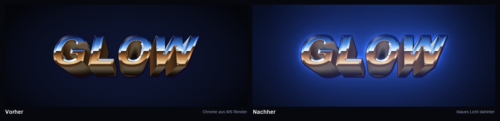
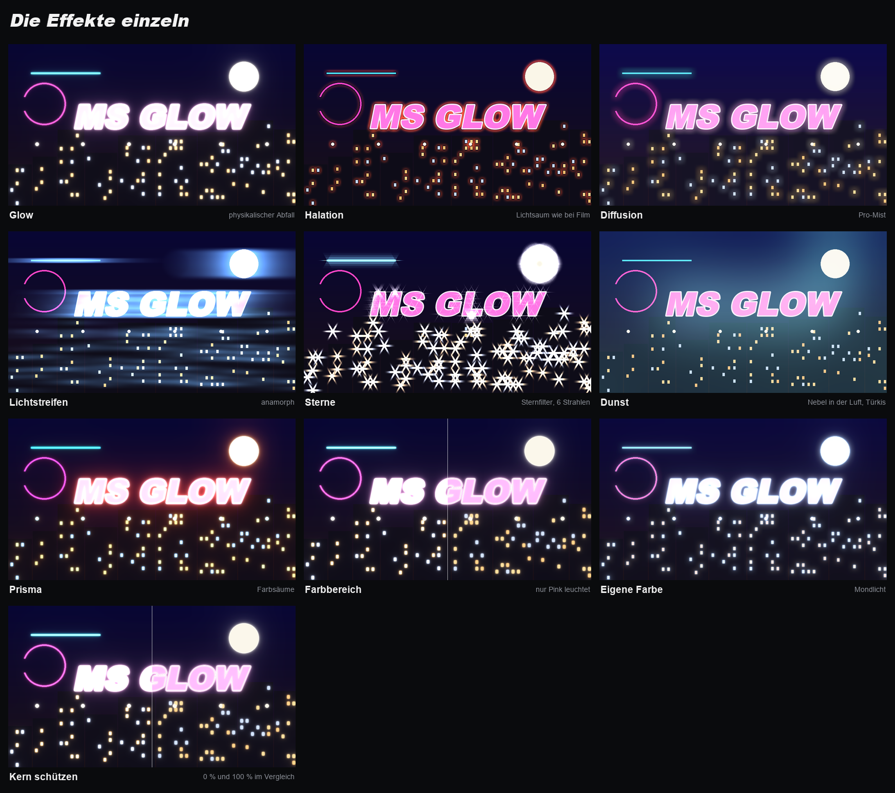
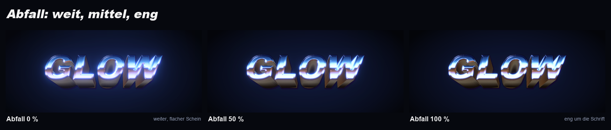

<p align="center">
  
</p>

<p align="center">
  <b>Realistisches Leuchten für Photoshop: weicher Glow mit physikalischem Lichtabfall, Halation, Pro-Mist,
  anamorphe Lichtstreifen, Sternfilter und Dunst – für das ganze Dokument oder einzelne Ebenen, nicht-destruktiv.</b><br>
  <sub>Photoshop 2023 (24.2) oder neuer · UXP-Panel</sub><br>
  <sub><b>MS</b> steht für <b>Morgenstern</b>: freie Photoshop-Tools · <a href="https://github.com/M0rgenst3rn/ms-distress">MS Distress</a> · <a href="https://github.com/M0rgenst3rn/ms-printer">MS Printer</a> · <a href="https://github.com/M0rgenst3rn/ms-render">MS Render</a> · <a href="https://github.com/M0rgenst3rn/ms-phase">MS Phase</a> · <b>MS Glow</b></sub>
</p>

---

## Was ist MS Glow?

MS Glow lässt die hellen Stellen deines Bilds leuchten, wie Licht durch eine Diffusionslinse oder auf altem
Filmmaterial. Das Leuchten fällt wie echtes Licht ab: hell und dicht an der Lichtquelle, mit einem langen,
weichen Ausläufer. Dazu kommen Halation, Pro-Mist, Dunst, anamorphe Lichtstreifen, ein Sternfilter und Farbsäume.

Alles wird prozedural berechnet, ohne Bilddateien. Jeder Effekt wird eine eigene Ebene, die dein Artwork nur
aufhellt. Das Original bleibt unverändert.

<p align="center"></p>

### Highlights

- **Ganzes Dokument oder einzelne Ebenen**: Beides ist nicht-destruktiv und lässt sich jederzeit entfernen
- **Glow mit echtem Lichtabfall**: Stärke, Radius, Schwelle und Farbe, im Feintuning Abfall, Kern schützen, Sättigung, Gamma und Prisma
- **6 Effekte als eigene Ebenen**: Glow, Halation, Diffusion, Dunst, Lichtstreifen und Sterne
- **Nur außen leuchten**: Das Objekt bleibt unverfärbt, der Schein liegt nur drumherum, z. B. eine Aura um Chrome-Schrift
- **Aufgeräumtes Panel**: aufklappbare Bereiche, eigene Farbpalette, das Wichtigste oben, alles Weitere im Feintuning
- **17 Looks** mit Vorschaubildern deines eigenen Motivs
- **Vorschau** des ganzen Bilds oder als Detail in 1:1, dazu **Live** im Dokument
- **Einstellungen in der Gruppe**: Gruppe auswählen, und das Panel lädt ihre Werte wieder
- **Selbsttest**: 47 Prüfungen gegen das echte Photoshop-Ergebnis

## 17 Looks

<p align="center"></p>

Ein Klick auf einen Look setzt alle Regler. Danach bleibt jeder Wert frei einstellbar. Die Vorschaubilder im
Panel zeigen jeden Look mit deinem eigenen Dokument oder deiner Ebene.

## Aura: nur außen leuchten

<p align="center"></p>

Mit **Nur außen** bleibt das Objekt selbst unverändert, und das Leuchten liegt nur drumherum. Im Beispiel ist das
eine Chrome-Schrift aus [MS Render](https://github.com/M0rgenst3rn/ms-render) mit dem Look **Chrome-Aura**: Das
Silber bleibt silbern, der Schein ist blau-violett. Bei „Nur Ebene“ nimmt MS Glow genau die Form der
Ebene, im ganzen Dokument alles, was sich deutlich vom dunklen Hintergrund abhebt.

## Die Effekte

<p align="center"></p>

| Effekt | Was passiert | Ebene |
|---|---|---|
| **Glow** | Weiches Leuchten mit physikalischem Abfall | Negativ multiplizieren oder Linear abwedeln |
| **Halation** | Rot-oranger Lichtsaum um helle Kanten, wie bei Filmmaterial | Negativ multiplizieren |
| **Diffusion** | Nebliger Weichzeichner wie ein Pro-Mist-Filter, das ganze Bild leuchtet weich nach | Negativ multiplizieren |
| **Dunst** | Sehr weiter Lichtschleier wie Nebel in der Luft, hebt die Schatten, mit eigener Farbe | Negativ multiplizieren |
| **Lichtstreifen** | Lange, waagerechte Streifen an hellen Punkten, wie bei anamorphen Objektiven | Linear abwedeln |
| **Sterne** | Sternfilter mit 4, 6 oder 8 Strahlen an einzelnen Lichtpunkten wie Lampen und Glanzlichtern | Linear abwedeln |

## Lichtabfall

<p align="center"></p>

Der Glow besteht aus vielen überlagerten Unschärfe-Stufen, jede doppelt so groß wie die vorige. Wie stark die
großen Stufen zählen, bestimmt der **Abfall**: Bei kleinen Werten entsteht ein weiter, flacher Schein, bei
großen ein enger Hof um die Lichtquelle. So verhält sich das Leuchten wie echtes Licht.

## Die Regler

| Bereich | Regler | Was er macht |
|---|---|---|
| Oben | **Deckkraft** | Stärke des ganzen Looks |
| Glow | **Stärke / Radius / Schwelle** | Helligkeit und Reichweite des Leuchtens, ab welcher Helligkeit etwas leuchtet |
| Glow | **Nur außen** | Im Objekt selbst kein Glow, der Schein liegt nur drumherum |
| Glow | **Farbe: Vom Licht oder Eigene** | Leuchten in der Farbe der Quelle oder einer eigenen aus der Palette |
| Effekte | **Halation** | Lichtsaum um helle Kanten |
| Effekte | **Diffusion** | Pro-Mist-Weichzeichner |
| Effekte | **Dunst / Dunst-Weite / Farbe** | Nebel in der Luft, z. B. türkis wie in einer nebligen Stadt |
| Effekte | **Lichtstreifen / Länge / Farbe** | Anamorphe Streifen |
| Effekte | **Sterne / Länge / Strahlen** | Sternfilter mit 4, 6 oder 8 Strahlen |
| Feintuning | **Abfall / Kern schützen** | Verlauf des Leuchtens; helle Flächen behalten ihre Zeichnung |
| Feintuning | **Sättigung / Gamma / Prisma** | Farbigkeit, ob auch Mitteltöne leuchten, Farbsäume (Rot reicht weiter als Blau) |
| Feintuning | **Glow-Art: Weich oder Kräftig** | Negativ multiplizieren oder Linear abwedeln |

Die Unter-Regler eines Effekts erscheinen erst, wenn der Effekt eingeschaltet ist. Ein Doppelklick auf einen
Regler setzt ihn zurück.

Alle Größen beziehen sich auf die Bildhöhe. Der Look sieht deshalb bei jeder Dokumentgröße gleich aus, und
die kleine Vorschau zeigt dasselbe wie das Ergebnis.

## Ebenen im Dokument

**Ganzes Dokument**: Oben im Dokument entsteht eine Gruppe **„MS Glow“**:
```
MS Glow           (Gruppe, Gesamt-Deckkraft)
├─ Sterne         Linear abwedeln
├─ Lichtstreifen  Linear abwedeln
├─ Halation       Negativ multiplizieren
├─ Glow           Negativ multiplizieren (oder Linear abwedeln)
├─ Diffusion      Negativ multiplizieren
└─ Dunst          Negativ multiplizieren
```
Es entstehen nur die Ebenen der Effekte, die du eingeschaltet hast.

**Nur Ebene**: Jede Ebene kommt in eine eigene Gruppe **„MS Glow · Name“**. Das Original liegt
unverändert darin, die Effekt-Ebenen darüber. Das Leuchten darf über das Objekt hinausstrahlen. Ebenenmasken
freigestellter Objekte werden berücksichtigt: Was die Maske verdeckt, leuchtet nicht. **Entfernen** stellt das
Original an derselben Stelle wieder her.

## Installation

### macOS (empfohlen)

1. Repository herunterladen (**Code → Download ZIP**) und entpacken
2. Im Terminal im entpackten Ordner ausführen:
   ```bash
   bash install-mac.sh
   ```
3. Photoshop (neu) starten → **Zusatzmodule (Plugins) › MS Glow**

### Alternative: UXP Developer Tool (macOS & Windows)

1. „UXP Developer Tools“ über die Creative-Cloud-App installieren
2. In Photoshop unter *Einstellungen › Zusatzmodule* den **Entwicklermodus** aktivieren
3. Im UXP Developer Tool **Add Plugin** wählen, dann `glow/manifest.json` → **Load**

## So benutzt du es

1. **Ziel wählen**: unter der Vorschau **Ganzes Dokument** oder **Nur Ebene**. Darunter steht, was gerade bearbeitet wird
2. **Look anklicken**: Die Vorschau zeigt das Ergebnis sofort
3. **Feinschliff**: Mit **Schwelle** bestimmst du, was leuchtet, mit **Stärke**, **Radius** und **Abfall**, wie es leuchtet
4. **Anwenden** klicken oder **Live** einschalten
5. **Später ändern**: Gruppe auswählen, Werte anpassen, erneut anwenden. Das Panel lädt die Einstellungen der Gruppe
6. **Entfernen** löscht den Look wieder. Bei Ebenen bleibt das Original unverändert stehen

**Tipp:** Hat sich dein Artwork geändert, klicke erneut auf „Anwenden“. Die Gruppe wird dann neu berechnet.

## Projektstruktur

```
glow/                Das Plugin (wird so in Photoshop geladen)
  manifest.json      Plugin-Beschreibung
  index.html         Panel-Oberfläche
  main.js            Photoshop-Anbindung (Gruppen, Ebenen, Vorschau, Live, Prüfen, Selbsttest)
  core.js            Licht-Engine, reines JavaScript
install-mac.sh       Packt das Plugin (.ccx) und installiert es
tools/               Test-Renderer, Testszene, Bilder dieser README, Icons
docs/images/         Beispielbilder
```

```bash
node tools/render-test.js in.raw 960 540 out.png dreamy   # einen Look ohne Photoshop rendern
node tools/make-showcase.js                                # Bilder dieser README neu erzeugen (braucht Python mit Pillow)
```

## Fehler gefunden? Ideen?

Melde dich gern! Am einfachsten über **[Issues](https://github.com/M0rgenst3rn/ms-glow/issues)** hier auf GitHub:
**New issue** klicken und kurz beschreiben, was passiert ist. Hilfreich sind Photoshop-Version, Betriebssystem
und gern ein Screenshot. Dafür brauchst du nur ein kostenloses GitHub-Konto. Verbesserungsvorschläge und
Wünsche für neue Funktionen sind genauso willkommen.

## Lizenz

[MIT](LICENSE): Du darfst den Code frei ansehen, verändern, weitergeben und auch kommerziell nutzen.
Einzige Bedingung: Der Lizenzhinweis bleibt in Kopien enthalten.

Adobe und Photoshop sind Marken von Adobe Inc. Dieses Projekt ist unabhängig und steht in keiner
Verbindung zu Adobe.

---

<p align="center"><sub>MS Glow · ein Tool von <b>Morgenstern</b><br>
Entwickelt von Linus Leinberger</sub></p>
