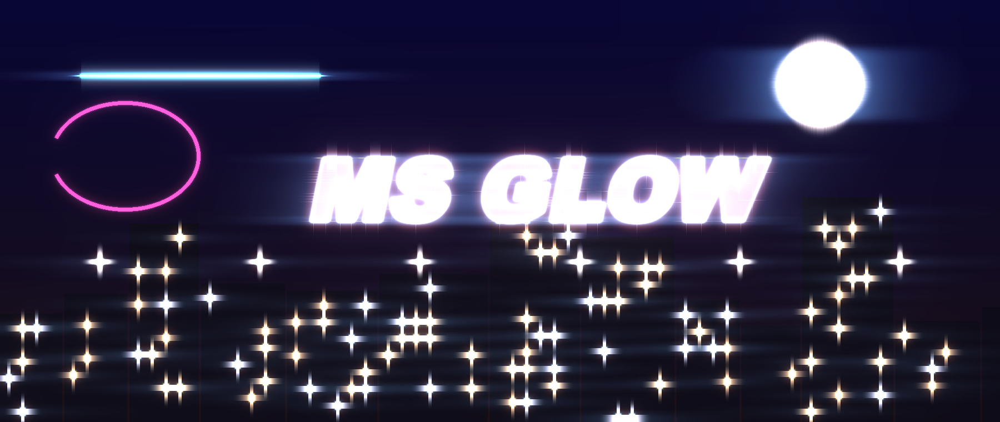
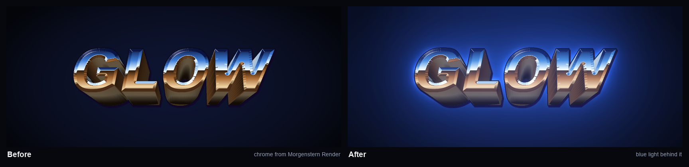
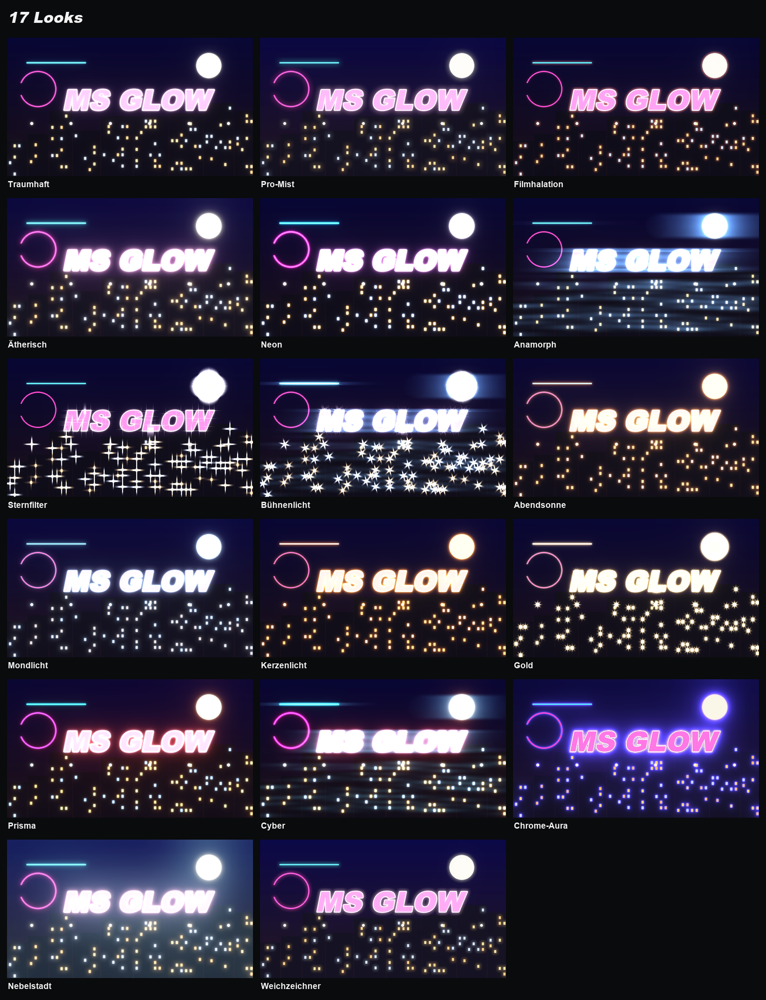
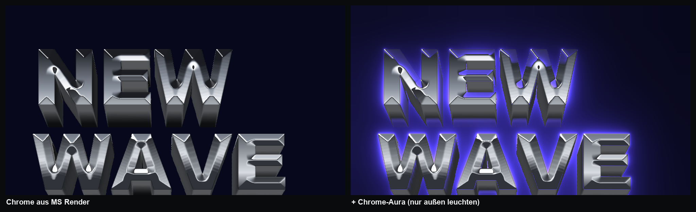
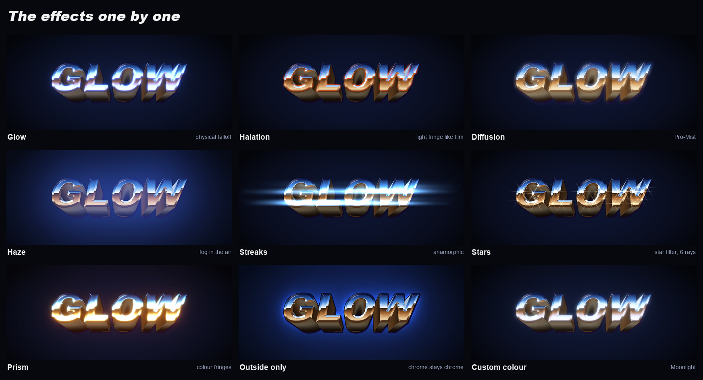
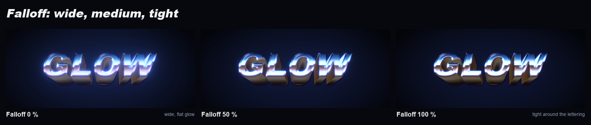

<p align="center">
  
</p>

<p align="center">
  <b>Realistic glow for Photoshop: soft light with a physical falloff, halation, Pro-Mist, anamorphic
  streaks, star filter and haze – for the whole document or single layers, non-destructive.</b><br>
  <sub>Photoshop 2023 (24.2) or newer · UXP panel</sub><br>
  <sub>More tools by <b>Linus Leinberger</b> · <b>Afterglow</b> · <a href="https://github.com/M0rgenst3rn/asciiwave">Asciiwave</a> · <a href="https://github.com/M0rgenst3rn/gradient-library">Gradient Library</a> · <a href="https://github.com/M0rgenst3rn/gridwork">Gridwork</a> · <a href="https://github.com/M0rgenst3rn/grime">Grime</a> · <a href="https://github.com/M0rgenst3rn/headliner">Headliner</a> · <a href="https://github.com/M0rgenst3rn/misprint">Misprint</a> · <a href="https://github.com/M0rgenst3rn/seamline">Seamline</a> · <a href="https://github.com/M0rgenst3rn/vhold">Vhold</a></sub>
</p>

---

## What is Afterglow?

Afterglow makes the bright parts of your image glow, like light through a diffusion filter or on old
film stock. The glow falls off like real light: bright and dense at the source, with a long, soft tail. On top
of that there are halation, Pro-Mist, haze, anamorphic streaks, a star filter and colour fringes.

Everything is computed procedurally, without image files. Every effect becomes its own layer that only
brightens your artwork. The original stays untouched.

<p align="center"></p>

Every image on this page shows the same workflow as in Photoshop: lettering turned into chrome with
[Headliner](https://github.com/M0rgenst3rn/headliner), and Afterglow on top with "Layer only".

### Highlights

- **Whole document or single layers**: both are non-destructive and can be removed at any time
- **Glow with a real falloff**: amount, radius, threshold and colour; falloff, protect core, saturation, gamma and prism in Fine-tuning
- **6 effects as separate layers**: glow, halation, diffusion, haze, streaks and stars
- **Outside only**: the object keeps its colours and the light sits only around it, e.g. an aura around chrome lettering
- **A tidy panel**: collapsible sections, its own colour palette, the essentials on top, everything else in Fine-tuning
- **17 looks** with previews of your own image
- **Preview** of the whole image or a 1:1 detail, plus **Live** in the document
- **Settings live in the group**: select the group and the panel loads its values again
- **Self-test**: 46 checks against the real Photoshop result

## 17 looks

<p align="center"></p>

One click on a look sets every slider. After that every value stays freely adjustable. The look previews in
the panel show each look with your own document or layer.

## Outside only

<p align="center"></p>

On the left the lettering itself glows too, and the chrome turns bright and blue. On the right **Outside only**
is on: the chrome stays chrome and the light sits only around it. With "Layer only" Afterglow takes
exactly the shape of the layer; in the whole document it takes everything that clearly stands out from the
dark background.

## The effects

<p align="center"></p>

| Effect | What happens | Layer |
|---|---|---|
| **Glow** | Soft light with a physical falloff | Screen or Linear Dodge |
| **Halation** | Red-orange fringe around bright edges, like film stock | Screen |
| **Diffusion** | Misty soft focus like a Pro-Mist filter, the whole image glows softly | Screen |
| **Haze** | Very wide veil of light, like fog in the air; lifts the shadows, with its own colour | Screen |
| **Streaks** | Long horizontal streaks on bright points, like anamorphic lenses | Linear Dodge |
| **Stars** | Star filter with 4, 6 or 8 rays on single points of light like lamps and highlights | Linear Dodge |

## Falloff

<p align="center"></p>

The glow is made of many stacked blur levels, each twice as large as the one before. How much the large
levels count is set by **Falloff**: low values give a wide, flat glow, high values a tight halo around the
light. That is how the glow behaves like real light.

## The sliders

| Section | Slider | What it does |
|---|---|---|
| Top | **Opacity** | Strength of the whole look |
| Glow | **Amount / Radius / Threshold** | Brightness and reach of the glow, and how bright something must be to glow |
| Glow | **Outside only** | No glow on the object itself, the light sits only around it |
| Glow | **Colour: From light or Custom** | Glow in the colour of the source or in one of your own from the palette |
| Effects | **Halation** | Light fringe around bright edges |
| Effects | **Diffusion** | Pro-Mist soft focus |
| Effects | **Haze / Haze reach / Colour** | Fog in the air, e.g. teal like a foggy city |
| Effects | **Streaks / Length / Colour** | Anamorphic streaks |
| Effects | **Stars / Length / Rays** | Star filter with 4, 6 or 8 rays |
| Fine-tuning | **Falloff / Protect core** | Shape of the glow; bright areas keep their detail |
| Fine-tuning | **Saturation / Gamma / Prism** | Colourfulness, whether midtones glow too, colour fringes (red reaches further than blue) |
| Fine-tuning | **Glow type: Soft or Strong** | Screen or Linear Dodge |

The sub-sliders of an effect only appear once the effect is on. Double-click a slider to reset it.

All sizes refer to the image height. So the look is the same at any document size, and the small preview
shows the same as the result.

## Layers in the document

**Whole document**: a group **"Afterglow"** is created at the top of the document:
```
Afterglow           (group, opacity)
├─ Stars          Linear Dodge
├─ Streaks        Linear Dodge
├─ Halation       Screen
├─ Glow           Screen (or Linear Dodge)
├─ Diffusion      Screen
└─ Haze           Screen
```
Only the layers of the effects you turned on are created.

**Layer only**: every layer gets its own group **"Afterglow · name"**. The original sits inside it unchanged,
the effect layers above it. The glow may reach beyond the object. Layer masks of cut-out objects are
respected: whatever the mask hides doesn't glow. **Remove** puts the original back in the same place.

## Installation

### macOS (recommended)

Open Terminal, paste this and press Enter. It downloads the plugin to your Downloads folder,
unzips it and installs it:

```bash
cd ~/Downloads && curl -fL -o afterglow.zip https://github.com/M0rgenst3rn/afterglow/archive/refs/heads/main.zip && unzip -oq afterglow.zip && cd afterglow-main && bash install-mac.sh
```

Then start Photoshop → **Plugins › Afterglow**

Prefer to do it by hand? Click **Code → Download ZIP**, unzip it, open Terminal in the unzipped folder and run
`bash install-mac.sh`.

### Alternative: UXP Developer Tool (macOS & Windows)

1. Install "UXP Developer Tools" from the Creative Cloud app
2. In Photoshop, turn on **Developer Mode** under *Settings › Plugins*
3. In the UXP Developer Tool choose **Add Plugin**, then `glow/manifest.json` → **Load**

## How to use it

1. **Choose the target**: **Whole document** or **Layer only** below the preview. Below that you see what is being edited
2. **Click a look**: the preview shows the result right away
3. **Fine-tune**: **Threshold** decides what glows; **Amount**, **Radius** and **Falloff** decide how it glows
4. Click **Apply** or turn on **Live**
5. **Change it later**: select the group, adjust the values, apply again. The panel loads the group's settings
6. **Remove** deletes the look again. With layers, the original stays as it was

**Tip:** if your artwork has changed, click "Apply" again. The group is then recomputed.

## Project structure

```
glow/                The plugin (loaded into Photoshop as is)
  manifest.json      Plugin description
  index.html         Panel UI
  ui.js/.css      Shared controls and design
  main.js            Photoshop side (groups, layers, preview, Live, verify, self-test)
  core.js            Light engine, plain JavaScript
install-mac.sh       Packs the plugin (.ccx) and installs it
tools/               Test renderer, README images, icons, browser preview of the panel
docs/images/         Example images
```

```bash
node tools/render-test.js in.raw 960 540 out.png dreamy   # render a look without Photoshop
node tools/make-showcase.js                                # rebuild the images of this README (needs Python with Pillow and Headliner next to this folder)
```

## Found a bug? Got an idea?

Get in touch! The easiest way is **[Issues](https://github.com/M0rgenst3rn/afterglow/issues)** here on GitHub:
click **New issue** and briefly describe what happened. Your Photoshop version, operating system and a
screenshot help a lot. All you need is a free GitHub account. Suggestions and feature requests are just as
welcome.

## License

[MIT with the Commons Clause](LICENSE): the plugin is free. You may use it for any work, including paid
client work, and you may read, change and share the code.
You may not sell the plugin or a version of it (changed or not), or charge for a product or service whose
value comes mainly from it.
Everything you create with it (designs, images, prints) is yours, and you may sell it.
The license notice stays in copies.

Adobe and Photoshop are trademarks of Adobe Inc. This project is independent and not affiliated with Adobe.

---

<p align="center"><sub>Afterglow<br>
Made by Linus Leinberger · <a href="https://www.instagram.com/linusleinberger">Instagram @linusleinberger</a></sub></p>
